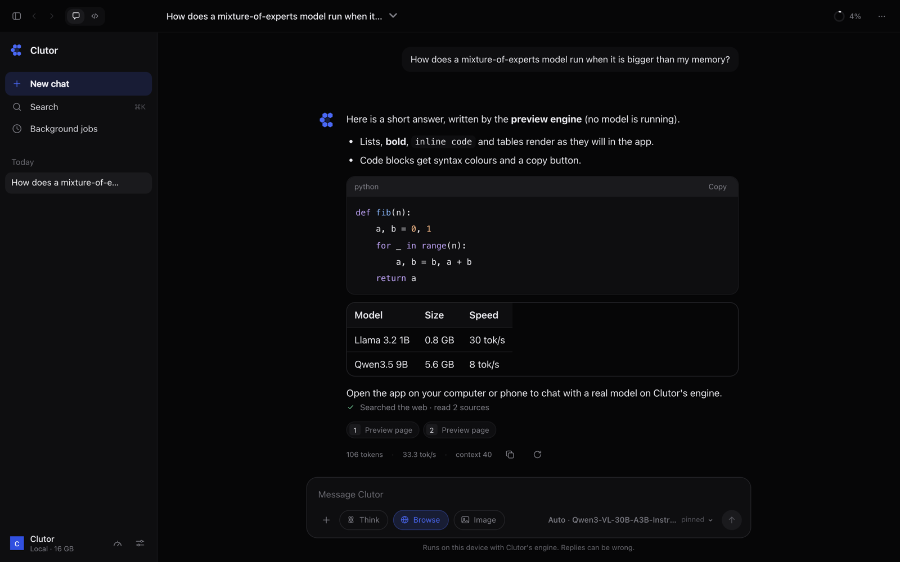
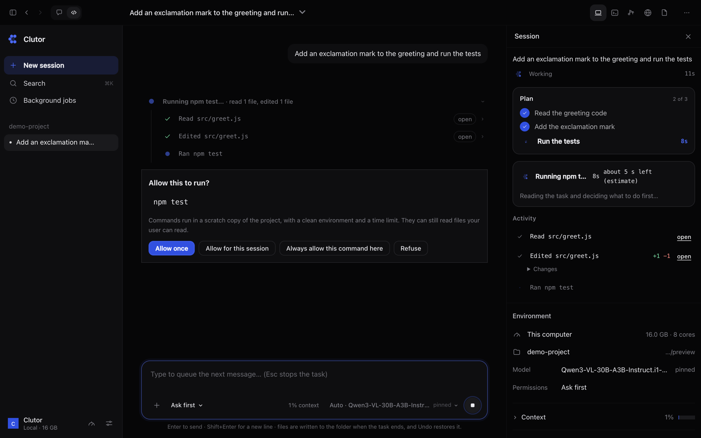
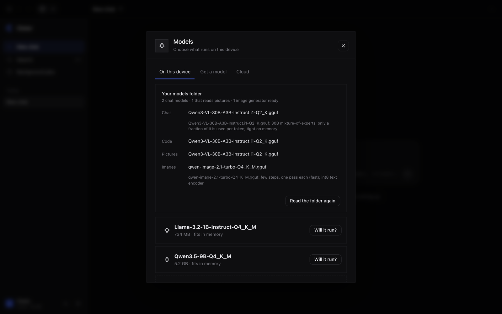
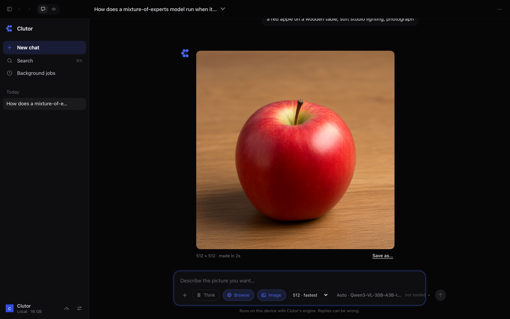
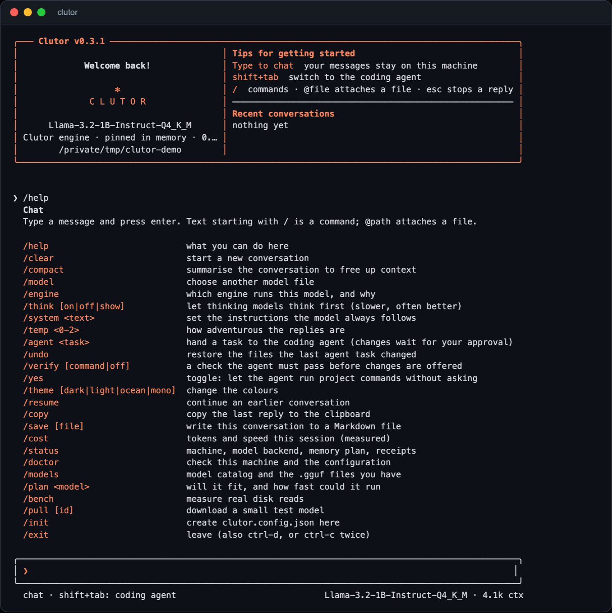
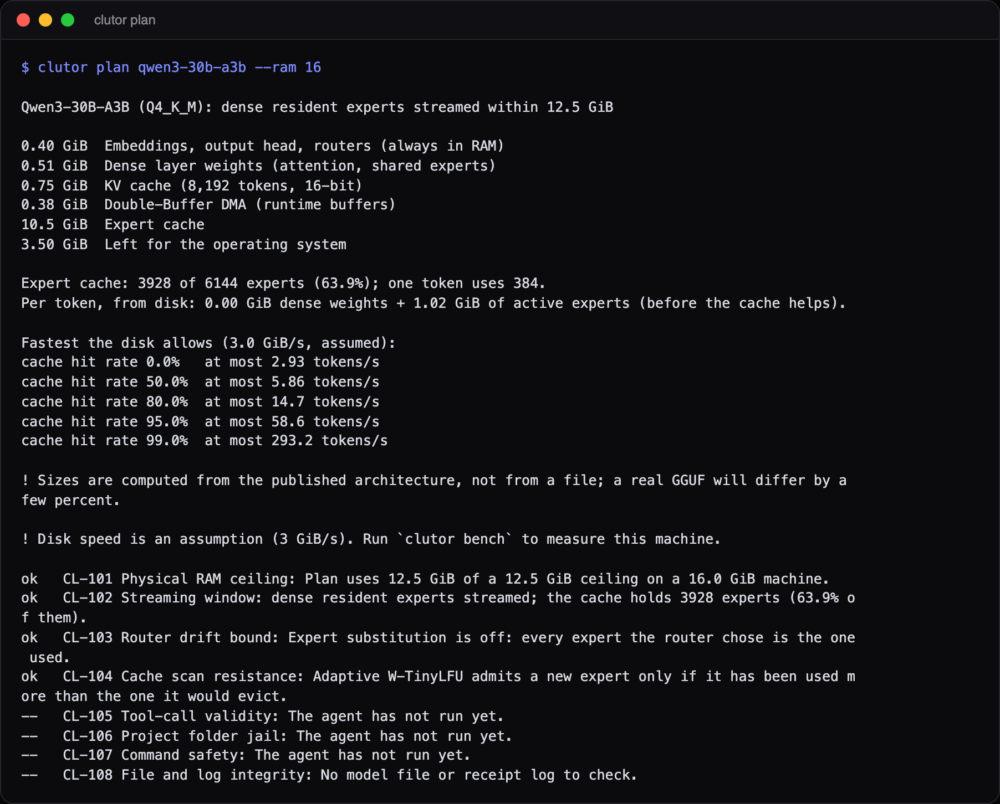

<p align="center">
  
</p>

<h3 align="center">Run mixture-of-experts models larger than your RAM, and know the real speed before you start.</h3>

<p align="center">
  <a href="https://github.com/isagarpinninti/clutor/actions/workflows/ci.yml"></a>
  <a href="https://www.npmjs.com/package/@clutor/cli"></a>
  <a href="LICENSE"></a>
</p>

<p align="center">
  <a href="#see-it"><b>See it</b></a> ·
  <a href="#what-it-does"><b>Features</b></a> ·
  <a href="#measured-on-this-hardware"><b>Numbers</b></a> ·
  <a href="#the-app"><b>App</b></a> ·
  <a href="#the-idea"><b>The idea</b></a> ·
  <a href="#install-and-run"><b>Install</b></a> ·
  <a href="#supported-models"><b>Models</b></a> ·
  <a href="#command-line"><b>CLI</b></a> ·
  <a href="#honest-status"><b>Status</b></a> ·
  <a href="#documentation"><b>Docs</b></a>
</p>

---

Clutor makes big models usable on ordinary computers. Its own C engine keeps the always-needed weights in memory and streams only the experts a token uses from your SSD, so a mixture-of-experts (MoE) model bigger than your RAM can still run. Before you start, the planner tells you whether a model fits, where the memory goes and the real ceiling on speed, and it labels every number as measured, computed or assumed.

On top of that engine sit a chat with pictures, a sandboxed coding agent and a picture generator, all on your own computer. Point Clutor at a folder of models and it works out what each file is and which one to use for which task.

**What this does not do:** the streaming helps MoE models only. A dense model bigger than your RAM is not made fast by it, and nothing makes a huge model fast on a slow disk. The planner says so before you download anything.

It has three parts:

| Part | What it is |
| --- | --- |
| **Engine** (`c/`) | Plain C with no dependencies. Reads GGUF files directly, runs the forward pass, and for mixture-of-experts models streams only the experts a token needs from disk through an adaptive cache with prefetch. |
| **App** (`app/`) | A desktop app (Tauri 2: Rust shell, system web view, React) with **Chat**, a **Code** agent, background jobs and MCP tools. Dark only, no Electron. |
| **Planner, CLI and agent** (`packages/`) | TypeScript. Answers "will this model fit, and how fast could the disk possibly let it go", and provides the terminal UI and the sandboxed coding agent. |

## See it

<table>
<tr>
<td width="50%"><br><sub><b>Chat</b>: streaming replies, web sources, think mode, background jobs.</sub></td>
<td width="50%"><br><sub><b>Code</b>: a plan that ticks off, grouped steps, approvals, a live activity panel.</sub></td>
</tr>
<tr>
<td><br><sub><b>Models folder</b>: what each file is, and which model each task will use.</sub></td>
<td><br><sub><b>Pictures</b>: describe it, the chat model steps aside, the image model makes it.</sub></td>
</tr>
<tr>
<td><br><sub><b>Terminal</b>: the same engine and agent in a terminal (`clutor`), drawn like the app: the logo, the dark theme with the same blue, your message as a block, a quiet speed line.</sub></td>
<td><br><sub><b>Plan</b>: will a model fit, where the memory goes, how fast the disk allows (`clutor plan`).</sub></td>
</tr>
</table>

<sub>The two terminal views are real output of the `clutor` command line, drawn by a terminal emulator (`scripts/capture-terminal.py`) with an empty home folder. The other screenshots are the interface running in a browser preview with sample data (see `app/src/bridge/mock.ts` and `scripts/capture-screenshots.mjs`), so the chat reply in the first one says that no model is running. The picture in the last one is a real output of Qwen-Image-2.1 Turbo made by Clutor on an Apple M2 (`docs/screenshots/sample-picture.jpg`, 512 × 512, 155 s); the rest of that screen, including its timing, is the preview's.</sub>

## Know before you run

Most tools say "this model needs 18 GB". Clutor answers the real question: can this machine run it, where does the memory go, and how fast could it possibly be. This is the output of `clutor plan qwen3-30b-a3b --ram 16` (trimmed), computed from the published architecture:

```text
Qwen3-30B-A3B (Q4_K_M): dense resident, experts streamed within 12.5 GiB

0.40 GiB  Embeddings, output head, routers (always in RAM)
0.51 GiB  Dense layer weights (attention, shared experts)
0.75 GiB  KV cache (8,192 tokens, 16-bit)
10.5 GiB  Expert cache      (3928 of 6144 experts, 63.9%)

Fastest the disk allows (3.0 GiB/s, assumed):
cache hit rate  0.0%   at most  2.93 tokens/s
cache hit rate 50.0%   at most  5.86 tokens/s
cache hit rate 95.0%   at most 58.6 tokens/s
```

Each figure is a ceiling set by disk speed and cache hits, not a promise. The disk speed here is an assumption until you run `clutor bench`, which measures your own drive. The app shows the same verdict before a model loads, and warns when a model will not fit in the memory that is free right now.

## What it does

- **Chat, with pictures.** Attach a picture and ask about it: Qwen3-VL models read it through their vision encoder (written in C in this repository; checked against an independent implementation and against llama.cpp). Chat can also use cloud models from a provider you set up (below).
- **A coding agent.** Plans, edits a private copy, runs your tests after asking, then writes the files to your folder with an undo point. Slash commands (`/help /clear /compact /undo /rewind /plan /init ...`), `@file` mentions, project instructions from `CLUTOR.md` (or `AGENTS.md`, `CLAUDE.md`), hooks (`.clutor/hooks.json`), read-only helper agents, saved command permissions, automatic compaction of a long session.
- **A picture generator, inside the app.** Qwen-Image-2.1 (and other models that stable-diffusion.cpp runs) is linked into the program itself. Turn on **Image** in the chat box; the chat model is unloaded while the picture is made, and loads again on your next message.
- **A models folder, understood.** Give it one folder. It reads the header of every GGUF and safetensors file and works out what each is (chat model, picture-reading model with its projector, image generator with its text encoder and VAE) and picks the most capable model that runs comfortably on this computer for chat, code, pictures and image generation. Turn **Auto** off any time to choose yourself.
- **Honest time estimates.** "Will it run?" says how much memory a model needs and how long a chat answer or a small coding task should take, labelled as estimated or measured; once a model has answered, its measured speed replaces the guess.
- **Cloud models, if you want them.** Anthropic, OpenAI, Google Gemini, OpenRouter, DeepSeek, Groq, Mistral, Together, Ollama or LM Studio on a machine you run, or any OpenAI-compatible address. The API key is kept by the app's native side and never shown again; using a provider needs a tick confirming that your messages leave this computer. Local models never send anything.

## The app

<table>
<tr><td width="50%">

**Chat**
- Streams replies from the model you load, on Clutor's own engine
- **Background jobs**: hand a slow question to a big model and come back to the answer; jobs survive a restart and resume where they stopped
- Think mode for reasoning models, with the thought process collapsible
- **Browse** (on by default, can be turned off): questions are looked up on the web first; the answer comes with numbered sources
- Model picker under the message box, context ring in the top bar

</td><td width="50%">

**Code**
- Pick a project folder and describe a change
- The agent edits a **private copy**, can run your tests there (asking first), then shows an exact diff
- **Apply** is refused if a file changed in the meantime; every apply keeps a checkpoint, so **Undo** works
- Side panel with **Terminal**, **Browser**, **Changes** and **Files**
- Permission modes: *Ask first*, *Auto-run checks*, *Plan only*
- **Web tools** for the agent (search and read pages), asked once per run
- **MCP client**: add stdio MCP servers for extra tools; the agent asks before calling any tool the server does not mark read-only

</td></tr>
<tr><td>

**Usage, not billing**
Context fill, tokens written, measured speed, model size against your RAM, whether the model is pinned in memory. All local: no quota, no cost.

</td><td>

**Designed to stay out of the way**
Nothing loads at launch (pinning several GB at once stalls a computer). Models larger than 40% of RAM are not pinned. Everything stays on the device.

</td></tr>
</table>

The app runs on macOS today. The same code is set up for Windows, Linux and Android; see [Honest status](#honest-status) for what has and has not been tested.

## The idea

A mixture-of-experts (MoE) model is huge on disk and small per token: only a few experts are active for each token. The always-needed part stays in RAM and the rest is read from disk when needed. That is how a model larger than memory can run at all, and Clutor exists to answer, with measurements, the question that "run a huge model on a laptop" claims skip: **how fast can the disk possibly let this go, and what does the cache actually buy?**

Rough physics, computed, not measured (disk assumed at 3 GB/s):

| Model | Read per token | Disk-bound ceiling |
| --- | --- | --- |
| Dense 100B at Q4 | about 56 GB | about 19 s per token |
| MoE with about 5B active parameters | about 3 GB | about 1 s per token |
| 671B MoE with 37B active | about 20 GB | about 7 s per token |

So large MoE models are usable for slow, background work, and dense models of that size are not. The app's background jobs exist for exactly that case. Run `clutor plan <model> --ram N` for the arithmetic on your machine, and see [docs/ENGINE.md](docs/ENGINE.md).

## Measured on this hardware

**Against llama.cpp on the same file** (Apple M2, 16 GB; details and the script in [docs/bench](docs/bench/README.md)): on a 30B mixture-of-experts model that fits in memory, the two CPU paths decode level within the noise (13.7 against 13.4 tokens/s); on a small dense 1B model Clutor is about 10% slower (50.5 against 56.5). llama.cpp on the GPU is faster at both, most of all at reading a prompt; the Clutor engine has no GPU backend. One machine only.

Everything below was measured on one computer: **an Apple M2 with 16 GB of memory**, running the models with nothing else heavy open. They are single runs, not benchmarks; other machines will differ.

| What | Result |
| --- | --- |
| Qwen3-VL-30B-A3B at **2-bit** (Q2_K/Q3_K, 10.5 GiB, fits in memory) | about **20 tokens/s** generating once the file is in memory; about **25 tokens/s** reading a prompt in a warm run |
| A picture to that model (448 × 448, 196 tokens) | 7.7 s to encode, about 25 s to read; about 35 s before the answer starts |
| Qwen3-30B-A3B at Q4_K_M (17.3 GiB, larger than memory), experts streamed from disk | about **4.7 tokens/s** with a 4 GiB cache, about 10 with 8 GiB (earlier run; the file is no longer on the machine) |
| Qwen-Image-2.1 **Turbo** Q4_K_M, 512 × 512, 8 steps | **155 s** inside the app; peak memory **8.0 GB** (15.9 GB without memory mapping) |
| Qwen-Image-2.1 **full** model, 512 × 512 | about 27 s per step, so 9 to 10 minutes for 20 steps (stopped early; not completed) |

**Not measured:** 768 and 1024 pictures, any machine other than this one, the engine on Windows or Linux. Picture generation on Windows and Linux uses the processor only (no GPU backend is built there yet), so expect it to be much slower than on this Mac; that is a guess, not a measurement.

## Install and run

### The desktop app (from source)

Requires Node.js 20+, a Rust toolchain and a C compiler.

```bash
git clone https://github.com/isagarpinninti/clutor.git && cd clutor
npm install
cd app && npm install
npm run tauri dev                  # run it
npx tauri build --bundles app      # macOS: builds src-tauri/target/release/bundle/macos/Clutor.app
```

**The image engine (optional).** Pictures come from [stable-diffusion.cpp](https://github.com/leejet/stable-diffusion.cpp) (MIT), linked into the app. `scripts/build-sd.sh` builds it from a pinned revision (macOS with Apple silicon uses the Apple GPU; Linux and Windows build for the processor); the app's build links it in when `CLUTOR_SD_DIR` points at the result, or when it finds a checkout at `../clutor-tools/stable-diffusion.cpp`. Without it the app builds and runs as before and says that the image engine is not included. CI builds it for macOS, Linux and Windows; only macOS has been run by the author.

```bash
CLUTOR_SD_DIR=$(scripts/build-sd.sh) npx tauri build --bundles app     # from app/
```

Put `.gguf` files in the app's models folder (shown in the app; override with `CLUTOR_MODELS=/path`), or use **Get a model** in the picker. The build is unsigned, so macOS may ask you to right-click the app and choose Open the first time.

### The command line

```bash
npm install -g @clutor/cli
clutor engine install     # prebuilt engine for macOS or Linux, SHA-256 checked (or: clutor engine build)
clutor                    # interactive terminal session
```

From a checkout: `npm install && npm run build && npm run engine`.

## Supported models

The native engine runs a real forward pass, checked against llama.cpp, for these architectures (Q4_K_M and similar quantizations):

| Family | Type | Notes |
| --- | --- | --- |
| OLMoE (`olmoe`) | MoE | experts streamed from disk |
| Qwen3-MoE (`qwen3moe`) | MoE | experts streamed from disk |
| Granite 3.0 MoE (`granitemoe`) | MoE | experts streamed from disk |
| Llama 3.x (`llama`) | dense | whole model read per token |
| Qwen2.5 (`qwen2`) | dense | |
| Qwen3.5 (`qwen35`) | hybrid dense (Gated DeltaNet + attention) | thinking models supported |
| Qwen3-VL (`qwen3vlmoe`) | MoE, **reads pictures** | text and pictures; needs the `mmproj` projector file next to it; checked on a 30B-A3B abliterated Q2_K build |

Weight formats: F32, F16, BF16, Q8_0, Q5_0, Q4_0, the K-quants **Q2_K, Q3_K, Q4_K, Q5_K, Q6_K** and the IQ formats (IQ1_S, IQ1_M, IQ2_XXS, IQ2_XS, IQ2_S, IQ3_XXS, IQ3_S, IQ4_XS, IQ4_NL). Integer dot products run as NEON kernels on Apple and ARM, and as AVX2 or AVX-512 VNNI kernels on x86, picked at run time from the CPU. The IQ unpackers are checked against the reference implementation's output, but no IQ model file has been run end to end, and the x86 kernels have not been timed.

**Image models** (through stable-diffusion.cpp, in the app): Qwen-Image-2.1 and Turbo as GGUF, with the Qwen3-VL-8B text encoder and the VAE. Only the Turbo Q4_K_M has been run here. Its licence (qwen-research) does not allow commercial use, and Clutor does not ship it: you download the files yourself. Other models the runtime supports (FLUX, Stable Diffusion and others) are recognised by the models folder but have not been tried.

DeepSeek, GLM, Kimi and Mixtral are known to the planner by their published shapes, but the engine has never opened one. Details and the exact agreement figures per model are in [docs/MODELS.md](docs/MODELS.md).

## Command line

| Command | What it does |
| --- | --- |
| `clutor` | Interactive terminal chat and agent (`/help` lists commands, `@file` attaches a file) |
| `plan <model>` | Memory plan from a catalog id or a real `.gguf` header: does it fit, where the memory goes, the disk-bound speed ceiling |
| `generate <file.gguf> "<prompt>"` | Native engine, real forward pass; `--cache-mb N` streams the experts from disk |
| `quality <file.gguf> <text>` | Perplexity and agreement of streamed or smart-routed runs against exact routing |
| `stream`, `bench` | Measure expert streaming and compare cache strategies on a file |
| `code "<task>"` | The coding agent in the terminal; review the diff, then `--apply` |
| `serve` | Local OpenAI / Ollama / MCP-compatible server |
| `pull`, `models`, `inspect`, `doctor`, `receipts`, `rollback` | Housekeeping, signed receipts, undo |

## How the engine streams experts

For every layer of every token the engine routes (top-k experts), looks the experts up in an adaptive W-TinyLFU cache, prefetches the next layer's likely experts with a pool of `pread` workers, overlaps that I/O with compute, and optionally routes to a cached expert when one is nearly as probable (bounded so no probability moves by more than a set amount). Pinning the model in memory (`--lock`) is a large speed-up for models that fit. Measured cache and I/O results, with what is measured, computed, simulated and assumed labelled on every number, are in [docs/STREAMING_RESULTS.md](docs/STREAMING_RESULTS.md).

## Honest status

What was verified, and what was not:

- **Verified:** the engine matches llama.cpp on tokenization and top tokens for the architectures above; the engine builds and passes its chat-protocol tests on Linux, macOS and Windows (MinGW) in CI; the app's agent, apply/undo, MCP client, job queue and usage logic are covered by unit tests, and the Rust file jail and command runner by Rust tests.
- **Verified for Qwen3-VL:** the dequantisers for Q2_K and Q3_K equal ggml's own on 2,000 random blocks each; the picture encoder equals an independent numpy implementation to 0.001% on all four outputs; on a test picture the engine and llama.cpp's `llama-mtmd-cli` give almost the same description; tokens equal llama.cpp's and the top next token agrees on six prompts, but the log-probabilities differ by 0.1 to 0.65 on average. That is the 2-bit model's sensitivity to rounding: the engine's own integer and float paths differ from each other by about as much.
- **A 2-bit model is imprecise** about details such as where things are in a picture; llama.cpp behaves the same way.
- **Only on macOS arm64:** all performance numbers, the desktop app itself, and picture generation.
- **Not tested by the author:** picture generation on Windows and Linux (it is built in CI but never run), the image engine with models other than Qwen-Image-2.1 Turbo, and any cloud provider with a real key (request building and response parsing are unit-tested; the whole path was exercised against the preview's canned answer).
- **Not tested by the author:** the app on Windows, Linux and Android (no Android build yet); MCP HTTP transport (stdio only); the AVX2 kernels beyond a CI unit test.
- **Limits of the agent:** it is only as reliable as the model behind it. Small models often make malformed tool calls; those are rejected, and every change is shown to you before anything is written. The command sandbox isolates the project and environment, **not the machine**: a command you approve can still read files your user can read.
- **Not claimed:** that a huge model runs fast. The planner prints the real ceiling for your disk.

See [docs/LIMITS.md](docs/LIMITS.md) and [docs/VISION_AUDIT.md](docs/VISION_AUDIT.md).

## Repository layout

```
c/                 native engine: GGUF parser, forward pass, I/O pool, cache, prefetch, kernels, chat library
app/               desktop app: src/ (React UI, agent, MCP, jobs), src-tauri/ (Rust: engine host, file jail, command runner)
packages/core/     planner, catalog, gates, agent core, receipts, server
packages/cli/      the `clutor` command, terminal UI, engine driver
app/src-tauri/image/   the small C layer that calls the image engine (stable-diffusion.cpp)
scripts/           build-sd.sh (the image engine), capture-screenshots.mjs (the screenshots above)
docs/              guides, engine design, models, limits, results, screenshots
examples/          sample clutor.config.json
```

## Documentation

| | |
| --- | --- |
| [Guide](docs/GUIDE.md) | Install, configure, connect an editor, plan a model, use the agent |
| [Native engine](docs/NATIVE_ENGINE.md) | The C engine: design, chat mode, cache policy, limits |
| [Models](docs/MODELS.md) | Which models run, and how they were checked |
| [Streaming results](docs/STREAMING_RESULTS.md) | Measured cache, I/O and stress-test results |
| [The agent](docs/AGENT.md) | Tools, jail, command policy, approvals, receipts |
| [Planner](docs/ENGINE.md) | The arithmetic and what is measured versus modelled |
| [Security model](docs/SECURITY_MODEL.md) | Who can talk to the server and how |
| [What works where](docs/CAPABILITIES.md) | Capability matrix by operating system, and how each cell is known |
| [Limits](docs/LIMITS.md) | What Clutor will not do |
| [Changelog](CHANGELOG.md) | What changed |

## Development

```bash
npm install
npm run gates                      # typecheck, lint, engine build and tests, unit tests, build, bench, smoke
cd app && npm test && cargo test --manifest-path src-tauri/Cargo.toml --lib
```

MIT licensed. See [CONTRIBUTING.md](CONTRIBUTING.md) and [SECURITY.md](SECURITY.md).
